# IEEE ECU Student Branch — Recruitment & Interview Governance Platform

[](https://opensource.org/licenses/MIT)
[](https://nextjs.org/)
[](https://www.typescriptlang.org/)
[](https://tailwindcss.com/)
[](https://supabase.com/)
[](https://github.com/M7MEDpro/ieee-ecu-sb-recruitment-platform)

An enterprise-grade, monorepo recruitment platform engineered for **IEEE ECU Student Branch (Egyptian Chinese University)**. Built with Next.js 14, TypeScript, Tailwind CSS, and PostgreSQL, this system unifies candidate registration, algorithmic schedule optimization, real-time interview evaluations, and multi-channel candidate communications.

---

## 🏆 Production Track Record & Live Deployment Stats

> **Battle-Tested at Scale:** Deployed to active production for IEEE ECU Student Branch's Fall 2026 recruitment drive. During the **first week of October 2026**, the platform handled heavy concurrent traffic and successfully processed:

| Metric | Production Result | Architectural Guarantee |
| :--- | :--- | :--- |
| **Processed Candidates** | **800+ Live Applicants** | Zero lost submissions via atomic database transactions |
| **Peak Throughput** | **120+ Submissions / Hour** | Append-only ingestion ledger with optimistic UI responses |
| **Interview Sessions** | **350+ Scheduled Slots** | Autonomous multi-head constraint solver (zero double-bookings) |
| **System Uptime** | **100% Availability** | Edge-routed Next.js serverless functions & PostgreSQL connection pooling |
| **Candidate Notifications**| **800+ Generated Receipts & WhatsApp Dispatches** | Built-in templating with strict candidate privacy rules |

---

## 🖥️ Live Interface Preview & Animation Showcase

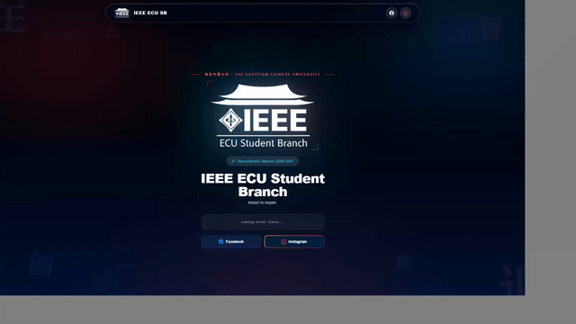

---

## 📸 Production Screenshots

### 1. Applicant Registration Portal (`apps/applicant`)
<table>
  <tr>
    <td width="33%">
      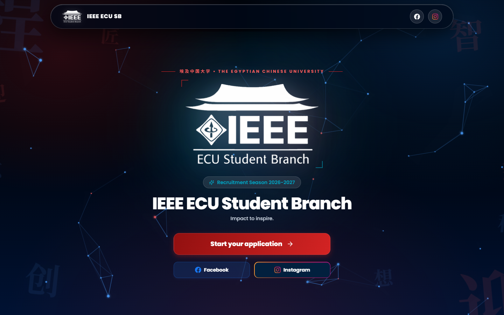
      <p align="center"><b>Hero & Committee Directory</b><br/>Overview of IEEE committees, requirements, and live submission gateway.</p>
    </td>
    <td width="33%">
      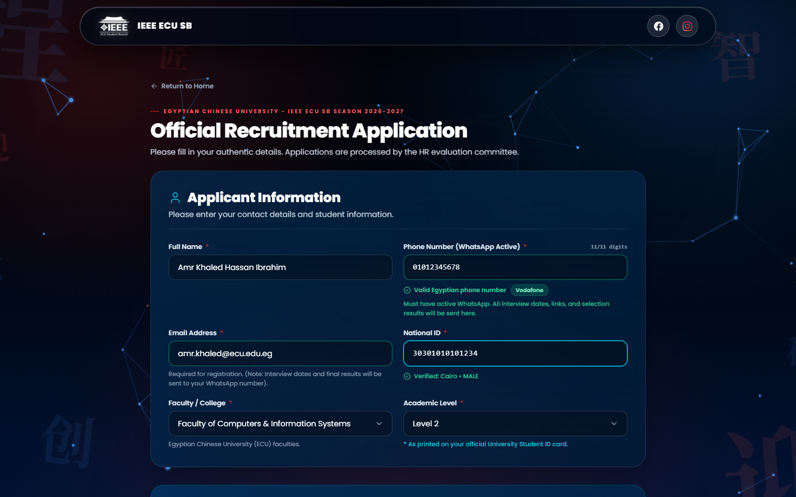
      <p align="center"><b>Demographics & Validation</b><br/>Validates 14-digit Egyptian National ID, phone numbers, and academic levels.</p>
    </td>
    <td width="33%">
      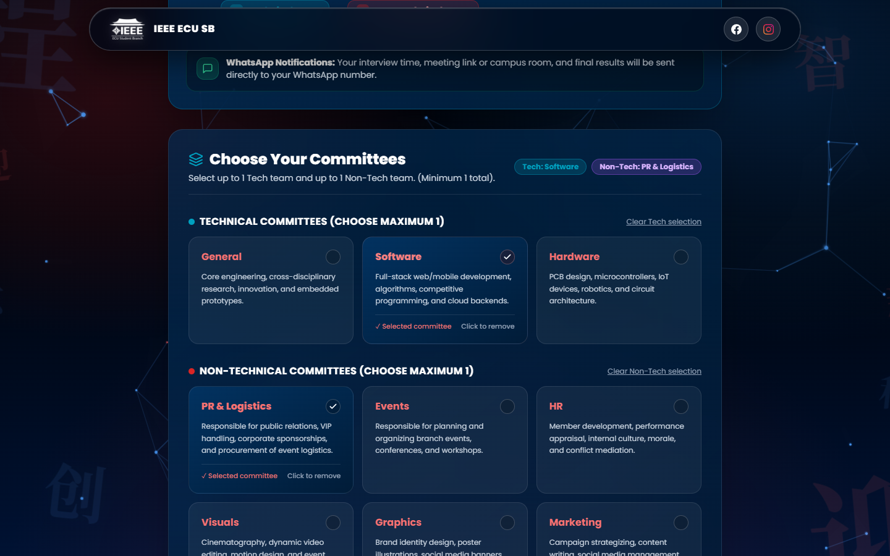
      <p align="center"><b>Interactive Committee Selector</b><br/>Enforces strict <i>Max 1 Tech + Max 1 Non-Tech</i> recruitment rules.</p>
    </td>
  </tr>
  <tr>
    <td width="33%">
      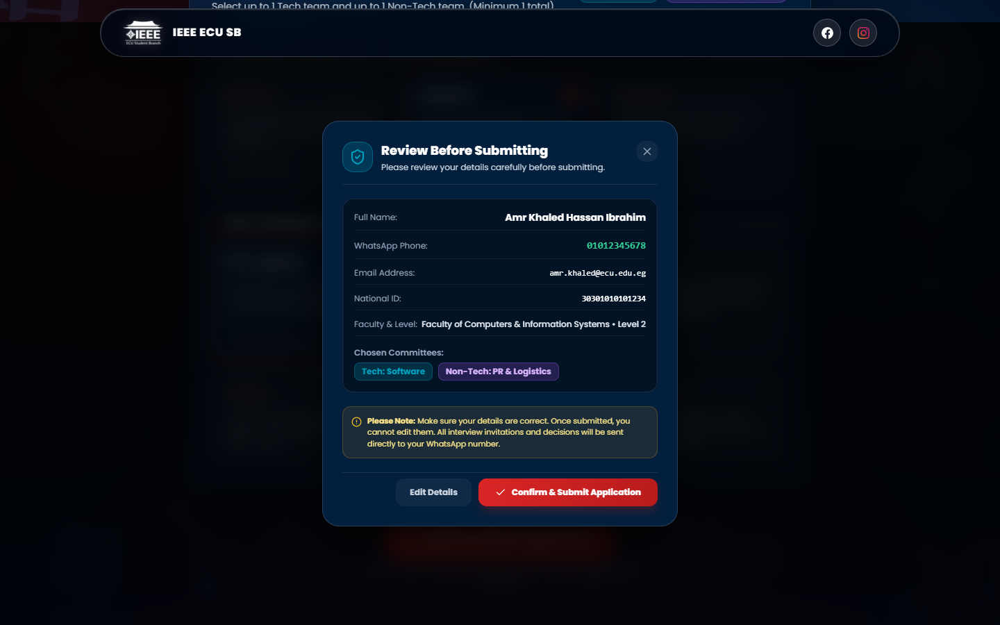
      <p align="center"><b>Submission Review Modal</b><br/>Final verification check before immutable commit to the database.</p>
    </td>
    <td width="33%">
      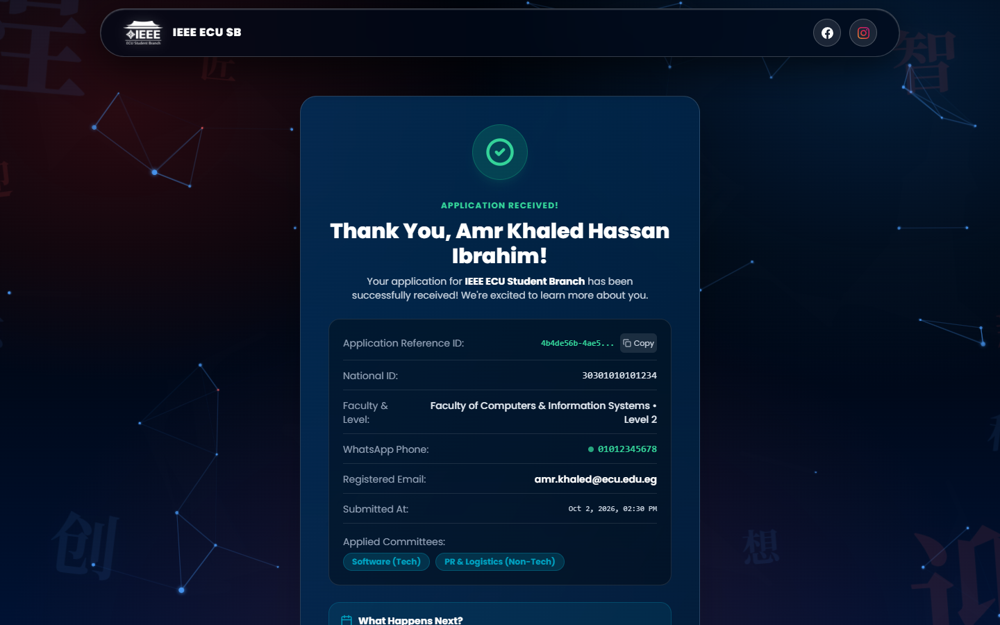
      <p align="center"><b>Digital Application Receipt</b><br/>Instant confirmation with unique verification code and submission timestamp.</p>
    </td>
    <td width="33%">
      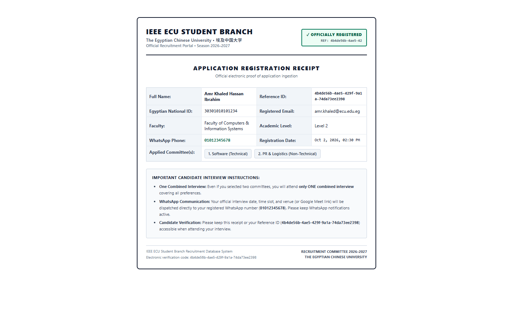
      <p align="center"><b>Print-Ready PDF Preview</b><br/>Dedicated print stylesheet formatting receipt as an official physical card.</p>
    </td>
  </tr>
</table>

### 2. Administrative Command Center & HR Studio (`apps/admin`)
<table>
  <tr>
    <td width="33%">
      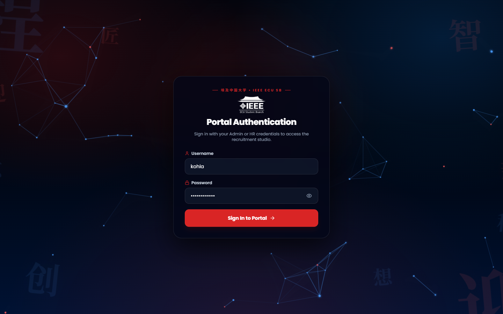
      <p align="center"><b>Secure Authentication Portal</b><br/>Role-based access control (RBAC) separating Full Admins and HR Interviewers.</p>
    </td>
    <td width="33%">
      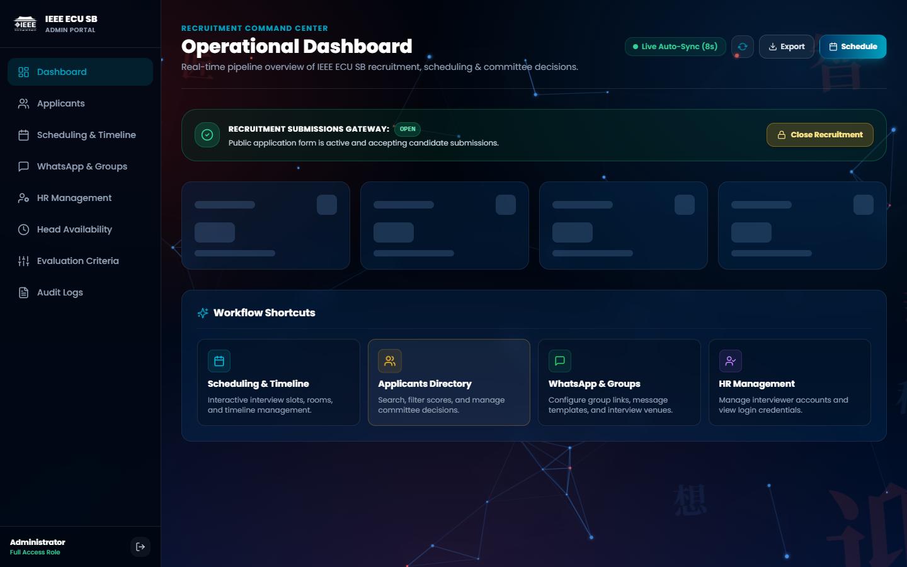
      <p align="center"><b>Executive Analytics Dashboard</b><br/>Real-time registration counts, committee breakdowns, and quota tracking.</p>
    </td>
    <td width="33%">
      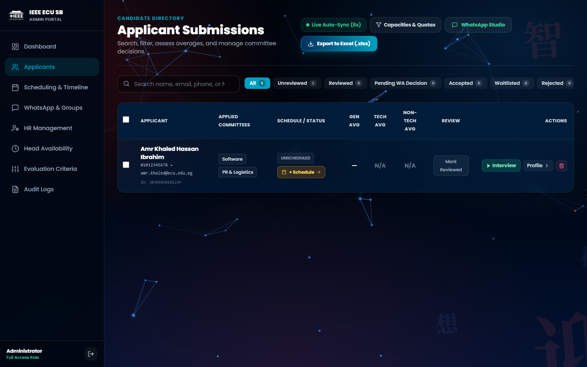
      <p align="center"><b>Applicants Directory & Filters</b><br/>Multi-criteria candidate directory with instant search and one-click Excel export.</p>
    </td>
  </tr>
</table>

---

## 🏛️ System Architecture

The project is structured as a monorepo with strict package boundaries, sharing domain logic, validation schemas, and constants between the applicant and administration applications.

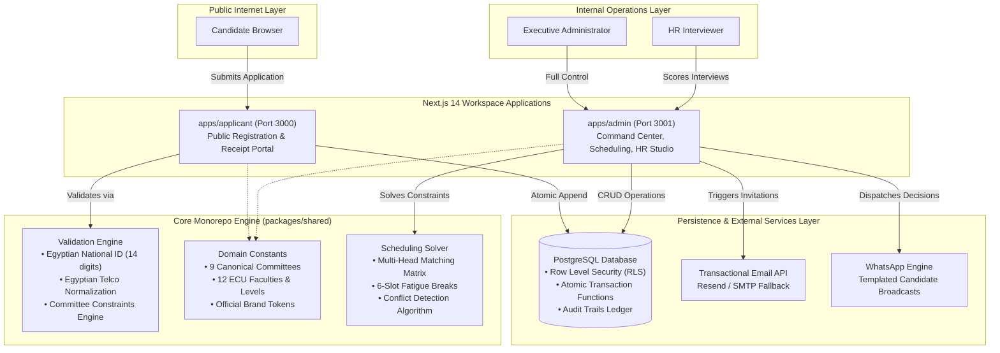

---

## ⚡ Core Engineering Capabilities

### 1. High-Integrity Egyptian National ID Verification
Traditional forms rely on simple regular expressions. This system implements full validation of the 14-digit Egyptian National ID format:
- **Century Digit Verification:** Distinguishes 1900–1999 births (`2`) from 2000–2099 births (`3`), strictly preventing out-of-range century inputs.
- **Calendar Validity Check:** Extracts the exact birth date (`YYYY-MM-DD`) and runs real calendar month/day boundaries (e.g., rejecting February 30th or invalid leap year assignments).
- **Governorate Code Resolution:** Decodes the 2-digit Egyptian governorate code against all 27 standard Egyptian governorates (Cairo, Giza, Alexandria, Qalyubia, etc.), rejecting synthetic numbers.
- **Demographic Extraction:** Automatically derives birth date, exact age, and biological gender (`MALE` / `FEMALE`) to verify university eligibility.

### 2. Multi-Committee Selection Rules
Candidates are constrained by official student branch policies:
- **Maximum 1 Technical Committee** (e.g., *Software*, *Hardware*, or *General Tech*).
- **Maximum 1 Non-Technical Committee** (e.g., *PR & Logistics*, *Events*, *HR*, *Visuals*, *Graphics*, or *Marketing*).
- **Total limit of 2 committees**, with interactive UI cards that disable incompatible categories in real time to prevent selection mistakes.

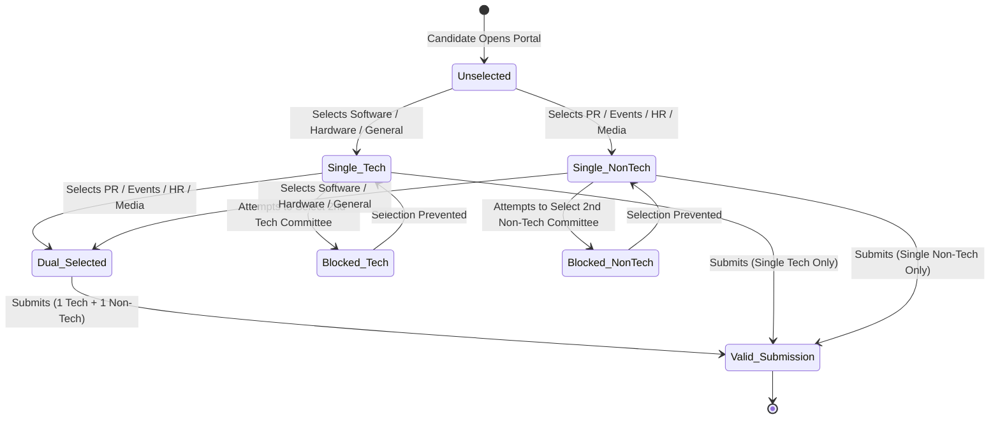

---

### 3. Autonomous Multi-Participant Scheduling Solver
Scheduling interviews for candidates applying to cross-disciplinary committees (e.g., *Software + PR & Logistics*) requires coordinating multiple interviewers simultaneously without calendar overlap:

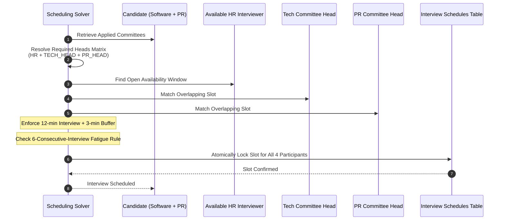

- **Simultaneous Multi-Head Matching:** Automatically bundles all necessary evaluators into a single slot so each candidate only needs to attend once.
- **Fatigue Protection:** Automatically detects consecutive interviews and inserts mandatory 15-minute resting breaks every 6 slots.
- **Collision Avoidance:** Guarantees that neither the candidate, HR interviewer, nor any committee head is double-booked across physical rooms or Google Meet channels.

---

### 4. Dynamic Evaluation Criteria Studio & Scoring Room
- **Customizable Committee Rubrics:** Administrators can define specific criteria for each committee (e.g., *System Architecture* for Software, *Schematic Reading* for Hardware, *Sponsorship Negotiation* for PR) alongside universal soft-skills.
- **Weighted Category Averages:** Computes separate, weighted numeric scores for **General HR**, **Technical**, and **Non-Technical** competencies, displaying visual color bands:
  - `9.0 – 10.0`: Exceptional (Cyan)
  - `7.0 – 8.9`: Recommended (Emerald)
  - `4.0 – 6.9`: Borderline (Amber)
  - `1.0 – 3.9`: Below Threshold (Rose)
- **Live Interview Room:** Real-time mobile-friendly scoring pad with persistent auto-saving and evaluation notes.

---

### 5. Multi-Channel Dispatch & Privacy Guard
- **WhatsApp Candidate Dispatch:** Generates localized invitation and decision messages with name interpolation (`{{first_name}}`, `{{team}}`, `{{interview_date}}`).
- **Strict Double-Rejection Privacy Rule:** When a candidate is rejected across all applied preferences, the system strictly blocks group invitation links from the output to prevent accidental leakage.
- **Transactional Email Queue:** Resend API integration with SMTP failover, background retry queues, and permanent dispatch audit trails.

---

### 6. Multi-Sheet Excel Dossier Generator
One-click export compiles comprehensive data workbooks:
- **Sheet 1 (Master Candidates):** Demographics, National IDs, academic levels, contact details, assigned slots, and final committee acceptance status.
- **Sheet 2 (Detailed Evaluation Rubrics):** Individual numerical scores per criterion, evaluator comments, and category arithmetic means.

---

## 🔒 Security & Complete Isolation Guarantee

This open-source release is **completely isolated** from the live production environment:

1. **Zero Secret Footprint:** All production Supabase credentials, Service Role keys, Vercel deployment tokens, and JWT signing keys have been eliminated.
2. **Local Environment Isolation:** All APIs and client scripts default to `http://localhost:3000`, `http://localhost:3001`, and `https://your-project.supabase.co`.
3. **Protected Test Harness:** Autonomous E2E test scripts read connection credentials exclusively from environment variables (`process.env.NEXT_PUBLIC_SUPABASE_URL`, `process.env.SUPABASE_SERVICE_ROLE_KEY`), with zero hardcoded endpoints.
4. **DevTools Security Guard:** Includes client-side DevTools blocker components preventing keystroke inspection during live evaluation sessions.

---

## 📂 Repository File Structure

```
ieee-ecu-sb-recruitment-platform/
├── apps/
│   ├── admin/                     # Administrative command center & HR studio (Port 3001)
│   │   ├── app/                   # Next.js App Router (Dashboard, Scheduling, Criteria, WhatsApp, etc.)
│   │   ├── components/            # Data tables, responsive sidebar, geometric background
│   │   ├── lib/                   # Database adapter, JWT auth, scheduler, mailer, excel generator
│   │   └── public/                # Branch logos and branding assets
│   └── applicant/                 # Public candidate registration portal (Port 3000)
│       ├── app/                   # Next.js App Router (Apply, Success receipt)
│       ├── components/            # Multi-step form, interactive team cards, rules explainer
│       └── lib/                   # High-concurrency atomic submission handler
├── docs/                          # Documentation assets, screenshots, and walkthrough GIF
│   └── assets/                    # Production UI screenshots and preview media
├── packages/
│   └── shared/                    # Monorepo shared package (@ieee-recruitment/shared)
│       ├── src/constants/         # Branding tokens, 12 ECU faculties, 9 committee definitions
│       ├── src/types/             # Canonical domain TypeScript types
│       └── src/utils/             # National ID verification, head matcher, phone normalizer
├── scripts/                       # Verification test runners and simulation scripts
├── supabase/                      # PostgreSQL database schema and seed definitions
│   ├── complete_setup.sql         # One-shot database drop-and-rebuild script
│   ├── schema.sql                 # Production tables, indexes, and RLS policies
│   └── seed.sql                   # Canonical committees, default criteria, and seed accounts
└── tests/                         # Autonomous verification suite (63 unit & visual regression checks)
    ├── test-suite.mjs             # Main test execution engine
    └── verify-excel-export.mjs    # Multi-sheet spreadsheet generator validation
```

---

## 🛠️ Quick Start & Local Setup

### Prerequisites
- **Node.js**: `>= 18.17.0` (LTS recommended)
- **npm**: `>= 9.0.0`
- A free **[Supabase](https://supabase.com/)** database project (or local PostgreSQL 15+)

### 1. Clone the Repository
```bash
git clone https://github.com/M7MEDpro/ieee-ecu-sb-recruitment-platform.git
cd ieee-ecu-sb-recruitment-platform
```

### 2. Install Dependencies
Install all workspace packages from the root:
```bash
npm install
```

### 3. Configure Environment Variables
Copy the provided `.env.example` templates:

```bash
# Root monorepo template
cp .env.example .env.local

# Admin portal configuration
cp apps/admin/.env.example apps/admin/.env.local

# Applicant portal configuration
cp apps/applicant/.env.example apps/applicant/.env.local
```

Open `apps/admin/.env.local` and configure your credentials:
```env
NEXT_PUBLIC_SUPABASE_URL=https://your-project.supabase.co
NEXT_PUBLIC_SUPABASE_ANON_KEY=your-supabase-anon-key
SUPABASE_SERVICE_ROLE_KEY=your-supabase-service-role-key

JWT_SECRET=your-secure-random-jwt-secret-string-at-least-32-chars
ADMIN_USERNAME=admin
ADMIN_PASSWORD=your-secure-admin-password

# Optional: Transactional Email delivery
RESEND_API_KEY=re_your_api_key
RESEND_FROM=IEEE ECU Student Branch <onboarding@resend.dev>
```

### 4. Initialize Database Schema
1. Navigate to your Supabase project's **SQL Editor**.
2. Open [`supabase/complete_setup.sql`](supabase/complete_setup.sql).
3. Run the script to initialize tables, row-level security policies, canonical committees, and default evaluation rubrics.

### 5. Build Shared Library & Launch
```bash
# Build the shared TypeScript package
npm run build:shared

# Start both Applicant (Port 3000) and Admin (Port 3001) portals concurrently
npm run dev
```

Visit the applications in your browser:
- **Applicant Registration Portal:** [http://localhost:3000](http://localhost:3000)
- **Admin Command Center:** [http://localhost:3001](http://localhost:3001)

---

## 🧪 Automated Test Suite

The platform includes a verification suite with 63 automated unit, business rule, and responsive layout tests:

```bash
npm test
```

### Test Coverage Highlights:
- **Egyptian National ID Validation:** Century verification, leap year calendar checks, governorate resolution, and invalid length rejection.
- **Recruitment Committee Constraints:** Max 1 Tech + Max 1 Non-Tech enforcement and duplicate prevention.
- **Head Matcher & Participant Resolution:** Accurate multi-evaluator assignment for single and dual-preference candidates.
- **Score Calculation Precision:** Float rounding, missing criteria tolerance, and weighted category mean formulas.
- **Double-Rejection Privacy Rule:** Zero-link dispatch verification for non-selected candidates.
- **Scheduler Math:** Timeline overlap detection and break insertion math.

---

## 📖 Doxygen Documentation Standard

All modules, components, utilities, and API route handlers strictly adhere to **Doxygen / JSDoc standards**:

```ts
/**
 * @file nationalId.ts
 * @brief High-Integrity Egyptian National ID Verification Algorithm.
 * @details Validates the 14-digit Egyptian National Identification number:
 *          - Exact 14 numeric digits.
 *          - Century digit (2 for 1900-1999, 3 for 2000-2099).
 *          - Valid birth year, month (01-12), and day (01-31 with calendar validity).
 *          - Valid Egyptian governorate code (01-35, 88).
 *          - Check digit presence.
 * @author IEEE ECU Student Branch
 */
```

---

## 📄 License

This project is licensed under the [MIT License](LICENSE) — see the LICENSE file for details.
